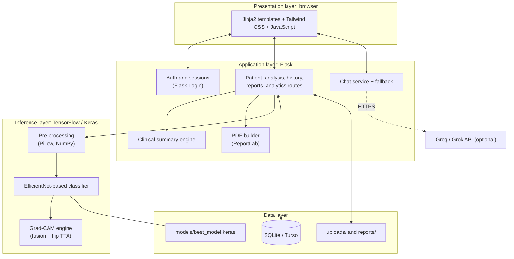
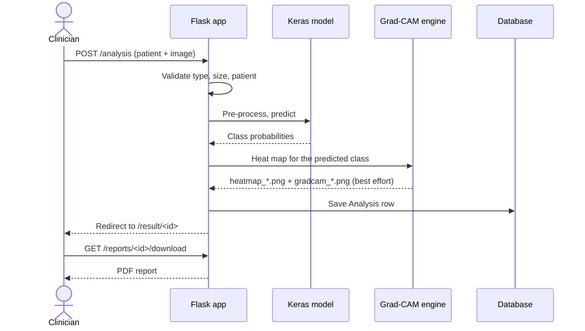
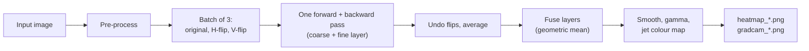
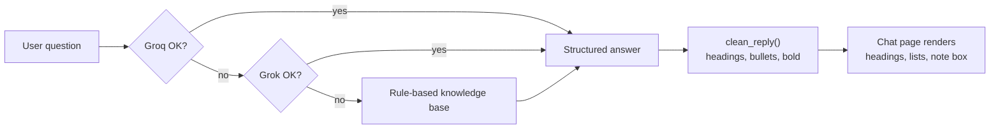
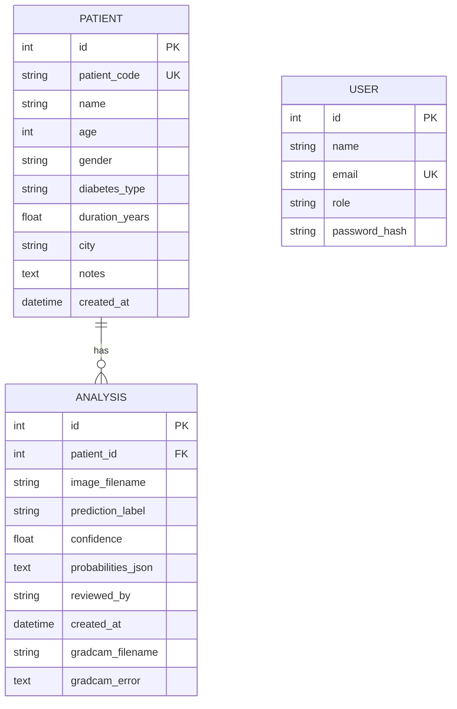

<div align="center">



<br/>


**A complete web platform that screens clinical images with a deep learning model, shows *why* it decided,
keeps patient records and produces a clinical-style PDF report.**

[Features](#-features) &nbsp;|&nbsp; [Screenshots](#-screenshots) &nbsp;|&nbsp; [How it works](#-how-it-works) &nbsp;|&nbsp; [Quick start](#-quick-start) &nbsp;|&nbsp; [Configuration](#-configuration) &nbsp;|&nbsp; [Roadmap](#-roadmap)

</div>

> [!WARNING]
> **DiaVision AI is a research and decision-support prototype. It is not a medical device, has not been clinically validated, and must not be used to diagnose or treat any patient.** Every result must be reviewed by a qualified clinician.

---

## Table of contents

- [Overview](#-overview)
- [Features](#-features)
- [Screenshots](#-screenshots)
- [How it works](#-how-it-works)
- [Tech stack](#-tech-stack)
- [Project structure](#-project-structure)
- [Quick start](#-quick-start)
- [Configuration](#-configuration)
- [The model: things that matter](#-the-model-things-that-matter)
- [Explainability (Grad-CAM)](#-explainability-grad-cam)
- [Clinical wording and confidence](#-clinical-wording-and-confidence)
- [AI assistant](#-ai-assistant)
- [Database](#-database)
- [Routes](#-routes)
- [Security notes and limitations](#-security-notes-and-limitations)
- [Roadmap](#-roadmap)
- [Contributing](#-contributing)
- [License](#-license)
- [Author and support](#-author-and-support)
- [Acknowledgements and references](#-acknowledgements-and-references)

---

## 🔭 Overview

Diabetes damages blood vessels all over the body. Its complications, such as **diabetic retinopathy**, **diabetic foot ulcers** and **skin lesions**, leave visible signs that can be photographed, and early screening prevents serious outcomes. The bottleneck is the small number of specialists who can read those images.

**DiaVision AI** turns a trained image classifier into a usable clinical workflow:

1. A clinician signs in, adds a patient and uploads an image.
2. The model predicts a class and a confidence value.
3. A **Grad-CAM heat map** shows which part of the image influenced the result.
4. The app writes **structured clinical wording** with cautions and suggested next steps.
5. Everything is saved, searchable and exportable as a **PDF report**.
6. An **AI assistant** answers questions about the app and the clinical background.

It began as a diabetic retinopathy screener and is **condition-agnostic**: class names, the "healthy" class and the condition name are set from a settings page, so the same code runs retinal, skin-lesion and wound models.

### Why this project is different

| Many AI demos | DiaVision AI |
|---|---|
| Stop at a trained model in a notebook | Full application: login, patients, history, analytics, reports |
| Show only a label | Show probabilities, confidence level, heat map **and** written findings |
| Overstate certainty | Flag low confidence as *indeterminate* and warn when a score is suspiciously high |
| Break when one part fails | Fail soft: the prediction is kept even if the heat map or the online assistant fails |
| Hard-code one disease | Configurable classes and condition |

---

## ✨ Features

### Screening workflow
- Drag-and-drop upload of **PNG, JPG, TIFF, BMP** (up to 20 MB) with a full-screen progress overlay.
- Create a patient on the fly or pick an existing one.
- Prediction with per-class probabilities and a confidence ring.
- Automatic image-size handling: the input resolution is read from the model itself.

### Explainable AI
- **Three-panel visual evidence**: (a) image, (b) Grad-CAM heat map, (c) superimposed visualisation.
- Fast Grad-CAM engine: one batched forward and backward pass, compiled once and cached.
- Optional layer fusion, Grad-CAM++, flip-averaging (test-time augmentation) and an **occlusion-sensitivity** alternative.
- Tunable look: blend, gamma and smoothing from `.env`.

### Clinical output
- Impression, statement, cautions and **suggested next steps** (eye, foot or generic wording).
- **Indeterminate** headline for low confidence; extra caution for scores of 99% and above.
- A structured **PDF report** for every analysis, with header, patient details, clinical report, impression, probability bars, visual evidence, next steps, limitations, signature line and disclaimer.

### Records and insight
- Dashboard with totals, flagged cases, recent screenings and recent patients.
- Patients list with search, patient profile, prediction history with filter.
- Reports page and analytics (totals, average confidence, distribution).

### AI assistant
- Chat page with robot and user avatars, time stamps, suggested questions, typing indicator and a copy button.
- **Structured answers** (headings, bullets, numbered steps, note box).
- Fallback chain: **Groq → Grok → built-in rule-based knowledge base**. It never leaves the user without an answer.

### Product polish
- Dark glass-style UI built with Tailwind CSS, responsive sidebar layout.
- Developer and support icons (LinkedIn, Instagram, call, WhatsApp) in the navbar, an animated multi-column footer and a Developer & Support page.
- **Class Setup page** to rename outputs and mark the healthy class without touching code.

---

## 🖼 Screenshots

<table>
  <tr>
    <td width="50%"><b>Sign in</b><br/></td>
    <td width="50%"><b>Upload and analyse</b><br/></td>
  </tr>
  <tr>
    <td><b>Analysing (progress overlay)</b><br/></td>
    <td><b>Result summary</b><br/></td>
  </tr>
  <tr>
    <td colspan="2"><b>Clinical interpretation</b><br/></td>
  </tr>
</table>

### Explainability: image, Grad-CAM heat map, superimposed

**Retinal fundus photograph**


**Skin lesion**


**Wound**


<table>
  <tr>
    <td width="50%"><b>PDF report</b><br/></td>
    <td width="50%"><b>Analytics</b><br/></td>
  </tr>
  <tr>
    <td colspan="2"><b>AI assistant with structured answers</b><br/></td>
  </tr>
</table>

> Screenshots use test data only.

---

## ⚙️ How it works

### System architecture



### What happens when you press "Analyze Image"



### Fail-soft design

| If this fails... | ...the app does this |
|---|---|
| Model file or TensorFlow missing | Starts anyway; every analysis shows the exact reason |
| Model outputs ≠ number of class names | Uses neutral names `Class 0..N` so no made-up diagnosis appears |
| Grad-CAM | Keeps the prediction, stores `gradcam_error`, shows a technical notice |
| Turso database unreachable | Falls back to local SQLite |
| Groq key wrong or offline | Tries Grok, then the rule-based assistant, and explains why |

---

## 🧰 Tech stack

| Area | Technology |
|---|---|
| Language | Python 3.10+ |
| Web | Flask, Jinja2, Flask-Login, Flask-SQLAlchemy, Werkzeug |
| Deep learning | TensorFlow / Keras (EfficientNet family), NumPy, Pillow |
| Reports | ReportLab |
| Database | SQLite (default) or Turso libSQL |
| Front end | Tailwind CSS (CDN), vanilla JavaScript, Material Symbols |
| Assistant | Groq (`openai/gpt-oss-120b`), Grok (`grok-4`), rule-based fallback |

---

## 📁 Project structure

```text
DiaVision-AI/
├── app.py                      # server: routes, models, inference, Grad-CAM, PDF, chat
├── requirements.txt
├── .env.example                # copy to .env and fill in
├── assets/banner.svg           # animated README banner
├── docs/screenshots/           # images used in this README
├── models/                     # put best_model.keras here (not committed)
├── uploads/                    # uploaded images and heat maps (not committed)
├── reports/                    # generated PDFs (not committed)
├── static/
│   ├── css/style.css
│   └── js/main.js
└── templates/
    ├── base.html               # sidebar, top bar, footer include
    ├── login.html  register.html  dashboard.html  analysis.html  result.html
    ├── patients.html  patient_profile.html  history.html  reports.html
    ├── analytics.html  chatbot.html  class_setup.html  developer.html
    ├── _developer_navbar.html  # LinkedIn / Instagram / call / WhatsApp icons
    ├── _footer.html            # multi-column animated footer
    └── _visual_evidence.html   # three-panel Grad-CAM block
```

---

## 🚀 Quick start

### 1. Clone and create a virtual environment

```bash
git clone https://github.com/<your-username>/DiaVision-AI.git
cd DiaVision-AI

python -m venv venv
# Windows
venv\Scripts\activate
# macOS / Linux
source venv/bin/activate
```

### 2. Install dependencies

```bash
python -m pip install -r requirements.txt
```

### 3. Add your trained model

The trained model is **not included** in this repository. Place your Keras model at:

```text
models/best_model.keras
```

If the file is missing, the app still starts and tells you exactly what is wrong when you try an analysis.

### 4. Create your `.env`

```bash
# Windows
copy .env.example .env
# macOS / Linux
cp .env.example .env
```

Open `.env` and at least set a long random `SECRET_KEY`. Everything else has a safe default. **Never commit `.env`.**

### 5. Run

```bash
python app.py
```

Open **http://127.0.0.1:5000**. A demo account is created on first start:

```text
doctor@diavision.ai  /  password123
```

> Change or delete the demo account before sharing the app with anyone.

### 6. Name your model outputs

Open **Settings → Class Setup** (`/settings/classes`), give each model output its real name (in the order the model was trained) and tick the class that means *not affected*.

> The app runs with `debug=False` and no reloader, so **restart it after any code change**.

---

## 🔧 Configuration

All settings come from environment variables (`.env`).

| Variable | Purpose | Default |
|---|---|---|
| `SECRET_KEY` | Signs session cookies. **Set your own.** | development value |
| `PREPROCESS_MODE` | `raw` (0 to 255) or `scale` (divide by 255) | `raw` |
| `CONDITION_NAME` | Name used in clinical wording | empty |
| `NOT_AFFECTED_CLASSES` | Comma-separated healthy class names | empty |
| `GROQ_API_KEY`, `GROQ_MODEL` | Groq assistant | empty, `openai/gpt-oss-120b` |
| `GROK_API_KEY`, `GROK_MODEL` | Optional second provider | empty, `grok-4` |
| `TURSO_DATABASE_URL`, `TURSO_AUTH_TOKEN` | Hosted database (needs `sqlalchemy-libsql`) | empty (SQLite) |
| `GRADCAM_METHOD` | `gradcam` or `occlusion` | `gradcam` |
| `GRADCAM_STYLE` | `paper` (3 panels) or `focus` (single overlay) | `paper` |
| `GRADCAM_FUSE` | `1` fuses a coarse and a fine layer, `0` is smoother | `1` |
| `GRADCAM_PLUS` | `1` uses Grad-CAM++ weights | `0` |
| `GRADCAM_TTA` | Flip averaging, 1 to 3 | `3` |
| `GRADCAM_LAYER`, `GRADCAM_FINE_LAYER` | Pick layers by name | last 4D layer, `block5f_add` |
| `GRADCAM_EDGE_TRIM` | Zero the outer ring of the feature map | `1` |
| `GRADCAM_BLEND` | Overlay strength, 0 to 1 | `0.45` |
| `GRADCAM_GAMMA` | Higher means a tighter hot spot | `1.4` |
| `GRADCAM_SMOOTH` | Higher means a softer map | `1.0` |
| `GRADCAM_THRESHOLD` | Cut-off for the `focus` style | `0.35` |
| `DEV_NAME`, `DEV_ROLE`, `DEV_BIO` | Developer card | placeholders |
| `DEV_LINKEDIN`, `DEV_INSTAGRAM` | Profile links | placeholders |
| `SUPPORT_PHONE`, `DEV_WHATSAPP`, `SUPPORT_EMAIL` | Contact; WhatsApp uses digits only, with country code and no `+` | placeholders |

---

## 🧠 The model: things that matter

DiaVision AI loads whatever Keras classifier you provide. Three details decide whether results make sense:

1. **Pre-processing must match training.**
   Keras EfficientNet contains its own rescaling, so it expects **raw 0 to 255 pixels**. Use `PREPROCESS_MODE=raw`. Dividing by 255 as well makes the input about 255 times too dark and ruins both the prediction and the heat map. Use `scale` only if you trained with `rescale=1/255`.
2. **Class order must match training.**
   If the names are in a different order than the model's outputs, you get a wrong label and a heat map for the wrong class. Folder-based loaders sort class folders alphabetically, which is a common cause.
3. **Input size is automatic.**
   The resolution is read from `MODEL.input_shape`, so no code change is needed for a different size.

At start-up the console prints the input shape, output units, the pre-processing mode and every layer name. Use that list to choose `GRADCAM_LAYER` or `GRADCAM_FINE_LAYER`.

---

## 🔥 Explainability (Grad-CAM)

For a class score *y<sup>c</sup>* and the feature maps *A<sup>k</sup>* of a convolutional layer:

```text
α_k = mean over i,j of  ∂y^c / ∂A^k_ij          (importance of channel k)
Grad-CAM = ReLU( Σ_k  α_k · A^k )               (coarse heat map)
```

DiaVision AI improves on the textbook version:



- **Raw score, not softmax.** When the last layer is softmax or sigmoid, the gradient is taken on the pre-activation score, because softmax saturates and kills gradients on confident predictions.
- **Speed.** The sub-model is built once and cached as a compiled `tf.function`.
- **Stability.** Flip-averaging reduces noise; edge trimming removes border artefacts.
- **Occlusion option.** `GRADCAM_METHOD=occlusion` slides a neutral patch across the image and measures the drop in confidence. It needs no gradients, but it is slower.

**Reading the result:** warm colours mean stronger influence on the prediction. A heat map is a guide to the model's attention, **not an outline of the lesion**, and saliency maps can look convincing even when they are unreliable, so always use them together with clinical judgement.

**Tuning tips**

| Symptom | Try |
|---|---|
| Speckled, many small blobs | `GRADCAM_FUSE=0` and `GRADCAM_SMOOTH=1.8` |
| Hot spot too broad | Raise `GRADCAM_GAMMA` (for example 1.8) |
| Photo hidden by colour | Lower `GRADCAM_BLEND` (for example 0.3) |
| Heat on the image border | `GRADCAM_EDGE_TRIM=2` |
| Heat map ignores the lesion | Check `PREPROCESS_MODE` and class order first |

---

## 🩺 Clinical wording and confidence

The summary text never names a disease the app does not know. It uses `CONDITION_NAME`, or "the target condition".

| Confidence | Level | Behaviour |
|---|---|---|
| 85% or higher | High | Normal wording. At 99% or higher a caution is added that a very high score does not guarantee correctness |
| 60% to 85% | Moderate | Normal wording, review advised |
| Below 60% | Low | Headline becomes **INDETERMINATE**, expert review required, repeat imaging suggested |

Suggested next steps differ for an eye finding (dilated fundus examination, referral timing), a foot finding (wound assessment, vascular and neuropathy review, off-loading) and a generic finding.

---

## 💬 AI assistant



- The system prompt fixes the assistant's role, forbids presenting output as a diagnosis, and requires: one direct sentence, two to four `## sections`, short `- bullets`, `**bold**` key terms and a final `Note:` line.
- Provider functions never raise; each failure is recorded as a short, key-free reason.
- The chat page builds messages with DOM methods (`textContent`), never `innerHTML`, so model output cannot inject HTML.
- The last 12 messages are kept in the session.

---

## 🗄 Database



A small migration runs at start-up and adds the two Grad-CAM columns to an older database, so upgrades never need a reset. The stand-alone heat map file is derived from `gradcam_filename` (`gradcam_X.png` → `heatmap_X.png`); older results simply show two panels.

---

## 🧭 Routes

| Route | Method | Purpose |
|---|---|---|
| `/login`, `/register`, `/logout` | GET, POST | Authentication |
| `/dashboard` | GET | Overview |
| `/analysis` | GET, POST | Upload form and processing |
| `/result/<id>` | GET | Result page |
| `/patients`, `/patients/<id>` | GET | List with search, profile |
| `/history` | GET | All analyses, filter by finding |
| `/reports`, `/reports/<id>/download` | GET | Reports list and PDF download |
| `/analytics` | GET | Totals and distribution |
| `/chatbot`, `/api/chatbot`, `/api/chatbot/reset` | GET, POST | Assistant |
| `/settings/classes` | GET, POST | Class Setup |
| `/developer` | GET | Developer and support |
| `/uploads/<file>` | GET | Serve images (login required) |

All routes except login and registration require an authenticated session.

---

## 🔐 Security notes and limitations

**Built in**

- Passwords stored as salted hashes (Werkzeug).
- All pages behind `login_required`.
- Extension whitelist, `secure_filename` and a 20 MB upload limit.
- Jinja2 auto-escaping; PDF text escaped; chat uses `textContent`.
- Secrets read from environment variables; `.env` is git-ignored.

**Known limitations (please read before deploying anywhere real)**

- ❌ No CSRF protection on forms yet.
- ❌ No role-based access: every signed-in user can see every patient.
- ❌ No audit log and no encryption of data at rest.
- ❌ Not assessed against HIPAA, GDPR or any other health-data regulation. Do not claim compliance.
- ❌ The model is **not clinically validated**. Heat maps show model attention, not pathology.
- ⚠️ Replace the default `SECRET_KEY` and remove the demo account.
- ⚠️ `uploads/`, `reports/` and `diavision.db` can contain patient data. They are git-ignored; keep it that way.

---

## 🗺 Roadmap

- [x] Login, patients, analysis, result page
- [x] Grad-CAM with fusion, flip-averaging and occlusion option
- [x] Three-panel visual evidence (image, heat map, superimposed)
- [x] PDF reports
- [x] History, analytics, dashboard
- [x] Structured AI assistant with fallback
- [x] Developer and support section, animated footer
- [ ] CSRF protection (Flask-WTF)
- [ ] Role-based access control and audit log
- [ ] Optional retina-circle / lesion mask for the heat map
- [ ] Model evaluation page (accuracy, sensitivity, specificity, AUC, confusion matrix)
- [ ] Automated tests (routes, clinical summary)
- [ ] Docker image and deployment guide
- [ ] Multi-language interface
- [ ] DICOM and hospital-system integration

---

## 🤝 Contributing

Contributions are welcome.

1. Fork the repository and create a branch: `git checkout -b feature/my-change`
2. Keep changes focused and describe how you tested them.
3. Never commit `.env`, patient data, uploads, reports or model files.
4. Open a pull request.

Bug reports with a screenshot and the console output are very helpful.

---

## 📄 License

Released under the [MIT License](LICENSE).

---

## 👤 Author and support

**Biswajit Pattanaik**

- LinkedIn: `https://www.linkedin.com/in/your-profile`
- Instagram: `https://www.instagram.com/your_username`
- Support: `+91 00000 00000`

*(Replace the placeholders above with your real links.)*

---

## 📚 Acknowledgements and references

- M. Tan and Q. Le, **EfficientNet: Rethinking Model Scaling for Convolutional Neural Networks**, ICML 2019.
- R. R. Selvaraju et al., **Grad-CAM: Visual Explanations from Deep Networks via Gradient-based Localization**, ICCV 2017.
- A. Chattopadhay et al., **Grad-CAM++: Generalized Gradient-based Visual Explanations for Deep Convolutional Networks**, WACV 2018.
- M. D. Zeiler and R. Fergus, **Visualizing and Understanding Convolutional Networks**, ECCV 2014.
- J. Adebayo et al., **Sanity Checks for Saliency Maps**, NeurIPS 2018.
- V. Gulshan et al., **Development and Validation of a Deep Learning Algorithm for Detection of Diabetic Retinopathy in Retinal Fundus Photographs**, JAMA 2016.
- C. P. Wilkinson et al., **Proposed International Clinical Diabetic Retinopathy and Diabetic Macular Edema Disease Severity Scales**, Ophthalmology 2003.

---

<div align="center">

If this project helps you, please consider giving it a ⭐

</div>
